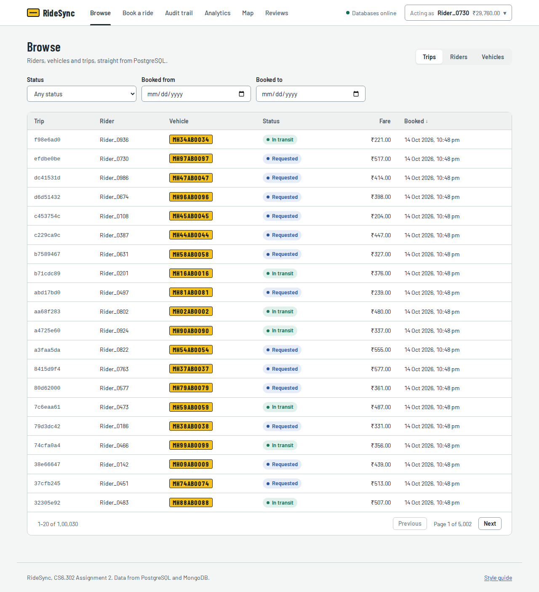
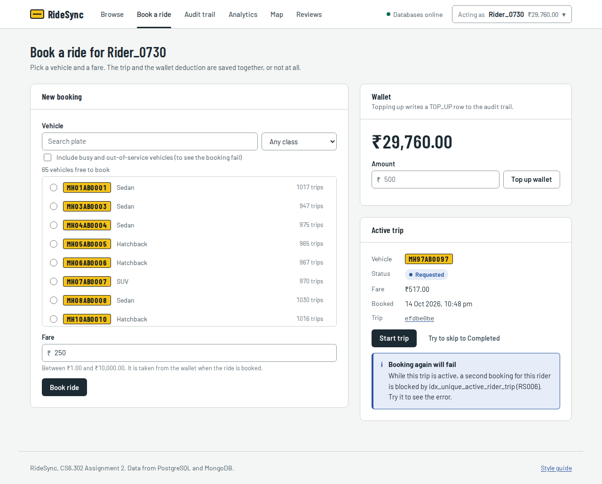
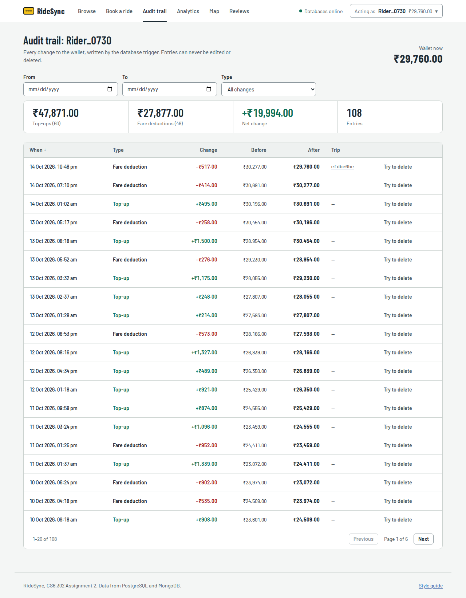
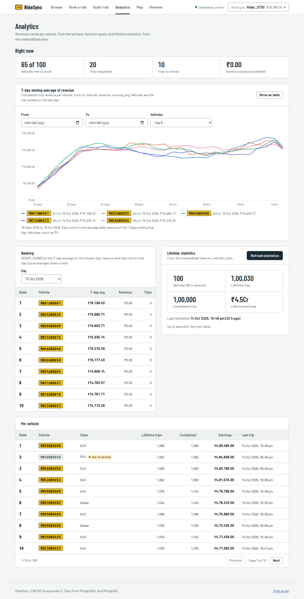
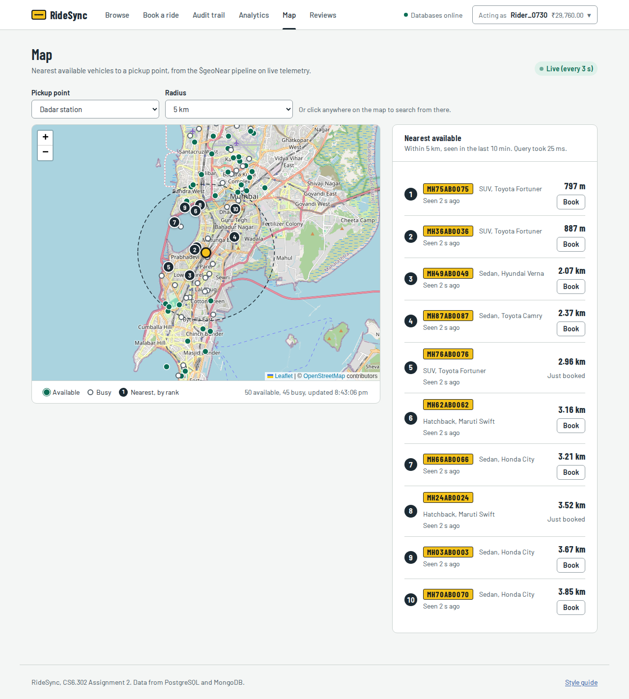
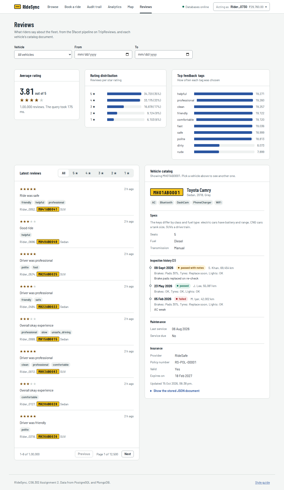
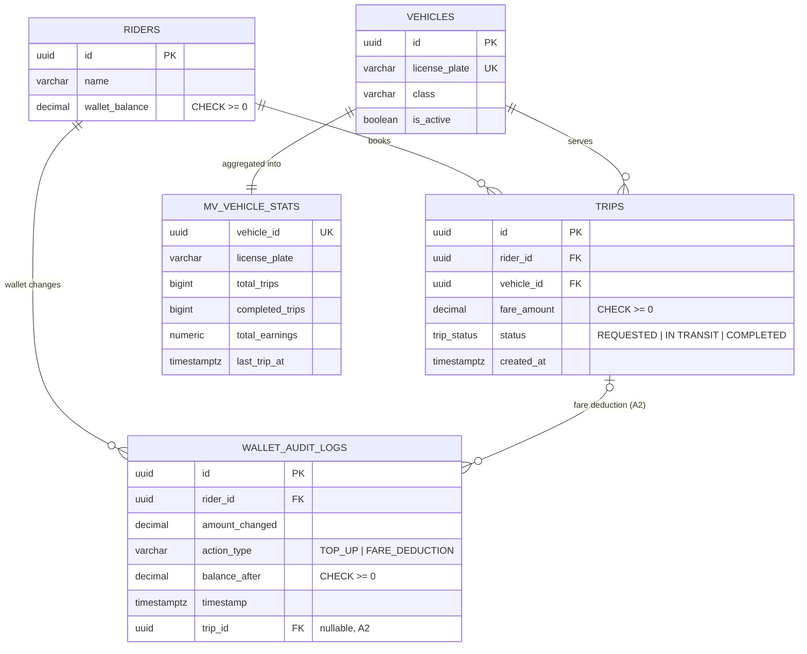

# RideSync: Team 11 (CS6.302 Assignment 2, Project 2)

A web front end and API for **RideSync**, a ride-hailing network, built on the PostgreSQL + MongoDB backend we inherited from
Assignment 1. A user can do the four Assignment 1 workflows in the browser instead of running scripts: book a ride, follow the
money in the audit trail, compare vehicle revenue, find the nearest free car, and read reviews. The databases do the real work
(stored procedures, triggers, a materialized view, window functions, `$geoNear`, `$facet`); the API only calls them.

| | |
|---|---|
| **Repository** | `https://github.com/RKSHub2026/SSD_A2_FrontEnd|
| **Final commit** | `c33b51f904af01beb3c76bc482500ece4c0bf0b0` (see [Submission checklist](#submission-checklist)) |
| **Demo video** |https://drive.google.com/file/d/1owsIZwh6422_IDwnliGGF9eBq5Dvt-64/view?usp=sharing
| **Inherited A1 repository** | https://github.com/dudekulamahammad/2026202016_a1 |
| **Team 11** | Muthiah Sivavelan, Rahul Singh, Gnanadeepak Yerra, Sanjay Gedela |

## Contents

1. [Quick start](#1-quick-start)
2. [Screens](#2-screens)
3. [Technology choices](#3-technology-choices)
4. [Project structure](#4-project-structure)
5. [Tests](#5-tests)
6. [Documentation](#6-documentation)
7. [Contribution](#7-contribution)
8. [Backend reference](#8-backend-reference)
9. [Changes to the inherited backend](#9-changes-to-the-inherited-backend)
10. [Assumptions](#10-assumptions)
11. [Performance evidence](#11-performance-evidence)

---

## 1. Quick start

**Requirements:** Node.js 22.9+ (tested on 22 and 26), PostgreSQL 13+ (tested on 16), MongoDB 5.2+ (tested on 8) with
`mongosh`, Python 3.9+. A browser with internet access for the map tiles (OpenStreetMap).

Run every command from the repository folder.

```bash
# 1. App and Python dependencies
cp .env.example .env                 # database settings for the app (edit PGPASSWORD if yours differs)
npm install
python3 -m venv .venv && source .venv/bin/activate
pip install psycopg2-binary pymongo

# 2. PostgreSQL: schema, procedures, triggers, view, then data (~1 min)
export PGHOST=localhost PGPORT=5432 PGUSER=postgres PGPASSWORD=ridesync PGDATABASE=ridesync_v2
createdb ridesync_v2
for f in sql/0*.sql; do psql -v ON_ERROR_STOP=1 -f "$f" || break; done
python3 data_generations/postgres_seeder.py          # ends with "SUCCESS: volume requirements met."

# 3. MongoDB: validators and indexes, then data
mongosh --quiet --file mongo/01_collections_and_indexes.js
python3 data_generations/mongo_seeder.py             # ends with "TelemetryPings : 500,000"
```

Then start two processes, each in its own terminal:

```bash
# terminal 1: live vehicle positions for the Map (one ping per car every 3 s)
source .venv/bin/activate && python3 data_generations/mongo_seeder.py --live

# terminal 2: API + web app
npm run dev                                          # "RideSync running on http://localhost:4000"
```

Open **http://localhost:4000**. The header badge should say "Databases online". Choose a rider in the header ("Choose a rider")
to book rides and see their audit trail.

**No local databases?** `docker compose up -d` starts PostgreSQL 16 (schema loaded from `sql/` on first start) and MongoDB 8
(indexes from `mongo/01`) with the same ports and password as `.env.example`. In steps 2 and 3, skip `createdb`, the `psql` loop and
`mongosh`; run the `export` line and the two seeders, then start the app as above.

| Script | What it does |
|---|---|
| `npm run dev` | App with auto-restart on file changes |
| `npm start` | App without watching |
| `npm test` / `npm run e2e` / `npm run test:db` | Test suites ([section 5](#5-tests)) |
| `npm run screenshots` | Saves screenshots of every screen from the running app into `docs/design/screens/` |
| `npm run wireframes` | Re-renders the wireframe PNGs from `docs/design/wireframes/wireframes.html` |
| `npm run lint` | Biome lint and format check |

---

## 2. Screens

Every screen handles loading (skeleton rows), empty results (a message saying what to do next) and errors (the database's reason,
with "Try again"). Nothing is ever a blank page. Layouts work at laptop size and down to 375 px on a phone.

| Screen | Spec requirement | How it is wired |
|---|---|---|
| **Browse** `#/browse` | Riders, vehicles, trips; pagination, search/filter, detail view | `GET /api/riders`, `/vehicles`, `/trips` (+ `/:id`): 20 rows per page, filters in SQL, never the whole table. Filters live in the URL |
| **Book a ride** `#/book` | Transaction (Workflow 1): balance before/after, friendly failures, the new audit row | `POST /api/trips` → `CALL sp_book_ride`. The result shows the balance before → after and the `FARE_DEDUCTION` row the trigger wrote. RS004 (balance), RS006/RS007 (partial unique indexes), RS003 are explained, with the next step offered |
| **Status moves** (Book a ride, trip detail) | Move a trip through its statuses to demonstrate the partial unique index | `PATCH /api/trips/:id/status` → `sp_update_trip_status`: Start trip, Complete trip. "Try to skip to Completed" shows RS009 |
| **Audit trail** `#/audit` | Read-only `wallet_audit_logs` for a chosen rider, date filter, running balance | `GET /api/riders/:id/audit`: before and after on every row, totals, date and type filters. "Try to delete" shows the trigger refusing (RS010) |
| **Analytics** `#/analytics` | 7-day moving-average chart, DENSE_RANK table, view summary with last refreshed and a refresh button | `fn_vehicle_revenue_moving_avg` → Chart.js line chart (plus a table view), ranking per day, `mv_vehicle_stats` totals, "N new trips not counted yet", `REFRESH … CONCURRENTLY` |
| **Map** `#/map` | `$geoNear` around a selectable origin, 5 km radius, list by distance, new pings without reload | Workflow 3 pipeline → Leaflet map with Mumbai pickup points (or click anywhere). The list is sorted by distance, and live updates arrive over server-sent events, with a polling fallback |
| **Reviews** `#/reviews` | `$facet` charts (ratings, top tags, average) and one flexible catalog document | Workflow 4 pipeline → rating distribution, top tags, average. The latest reviews, and the vehicle's `VehicleMetadata` document laid out readably (specs differ by fuel type, inspection history), plus the raw JSON |
| **Actor switcher** (header) | Switch users for the demo | Search riders, or list them by lowest balance. Remembered across reloads |

| | |
|---|---|
|  |  |
|  |  |
|  |  |

More screenshots (errors, the phone layout) and the wireframes are in [`docs/design/`](docs/design/README.md). Refresh the ones above
from your running app with `npm run screenshots`.

---

## 3. Technology choices

| Choice | Why |
|---|---|
| **Node.js 22 + Express 5** for the API | Small and well known. Express 5 forwards errors from `async` handlers by itself, so every route stays a few lines. The same language as the browser, so `shared/` (error catalogue, constants, formatting) is used by both sides |
| **`pg` and `mongodb` drivers, no ORM** | The assignment's logic lives in the database. An ORM would hide the procedures, triggers and pipelines we want to call directly. All SQL uses bound `$n` parameters |
| **Zod** for request validation | One schema per endpoint gives typed, defaulted input and per-field messages, which the forms show under the right field |
| **Plain HTML, CSS and JavaScript (ES modules), no framework or build step** | Six screens don't need React. The browser loads the modules straight from Express, so there's nothing to compile, and anyone can read the code. A 140-line hash router keeps filters and pages in the URL |
| **Chart.js** | A line chart with hover tooltips in a few lines; served from `node_modules`, no CDN. The rating and tag bars are plain HTML, so they need no library and read well with a screen reader |
| **Leaflet + OpenStreetMap** | A free map with no API key; circles and markers for the 5 km search |
| **Server-sent events, falling back to polling** | Map updates only flow server → browser, which SSE does over plain HTTP. Change streams need a replica set, so on a standalone MongoDB the server polls every 3 s; if the stream fails, the browser polls |
| **`node:test` + Playwright** | The built-in test runner for the API (no extra dependency, uses `fetch`), and Playwright to click through the real screens |
| **Biome** | One fast tool for lint and format |

---

## 4. Project structure

```
README.md
docs/
  handover_note.md         what we inherited, what worked, what we changed, suggestions for the A1 team
  api_endpoints.md         every endpoint: inputs, outputs, errors, the database object behind it
  design/                  users, wireframes (wireframes/), style guide, screenshots (screens/)
sql/  mongo/  data_generations/  performance/     Assignment 1 backend (+ our fixes, section 9)
api/                       Express server: routes/ -> services/ -> db/ (PostgreSQL, MongoDB)
shared/                    used by API and browser: error catalogue, constants, formatting (schemas: API only)
web/                       the front end: index.html, css/ (tokens, base, components, screens), js/ (lib, components, screens)
test/                      api/ (node:test), e2e/ (Playwright), db/ (SQL), support/ (test database + fixtures)
docker-compose.yml         optional: PostgreSQL + MongoDB in containers
```

The request flow is `web/js/screens/*` → `web/js/lib/api.js` → `api/routes/*` (validate) → `api/services/*` (call the
procedure, query or pipeline) → database. Errors come back as `{ error: { code, title, message, … } }` and are shown by
`web/js/components/ui.js`.

---

## 5. Tests

```bash
npm run test:db       # SQL tests for procedures, triggers, view, window function (rolled back)       ~1 s
npm test              # 41 API tests on a fresh ridesync_test database                                ~20 s
npm run e2e:install   # once: download Chromium
npm run e2e           # 15 browser tests on a fresh ridesync_e2e_test database (own server on :4100)  ~1 min
```

The tests focus on the riskiest part, money:
- every booking failure (insufficient balance, a second active trip, a busy or inactive vehicle, bad input) must answer with the
  right message **and** leave no trip, deduction or audit row behind
- the audit log must stay append-only
- the moving average, the ranking and the view's refresh must be mathematically right
- the MongoDB pipelines must match the Assignment 1 scripts

Your seeded data is never touched. What is tested and why is in [`test/README.md`](test/README.md).

---

## 6. Documentation

| Document | Contents |
|---|---|
| [`docs/handover_note.md`](docs/handover_note.md) | What worked, what didn't, what we changed and why, suggestions for the original authors |
| [`docs/api_endpoints.md`](docs/api_endpoints.md) | The API sketch: 23 endpoints with inputs, outputs and errors |
| [`test/README.md`](test/README.md) | Test strategy |
| [`MongoCommands.txt`](MongoCommands.txt) | MongoDB command reference |

---


---## 7. Contribution

What each member did:

| Member | Design | Code | Docs, tests, demo |
|---|---|---|---|
| Rahul Singh | API sketch: endpoints, inputs, outputs and the shared error format | Express API (Phases 1–2): browse endpoints; booking, status changes and top-up; audit trail; analytics and view refresh; map (nearest, fleet, live stream); reviews and catalog; request validation and error mapping | `docs/api_endpoints.md` |
| Gnanadeepak Yerra | Users and their tasks, screen map, wireframes, style guide (colours, type, components) | Front-end base (Phases 3–4): design tokens and CSS, reusable components, hash router, actor switcher; Browse, Book a ride and Audit trail screens 
| Muthiah Sivavelan | Layouts for Analytics, Map and Reviews; chart colour palette | Phase 5: Analytics (Chart.js moving average, ranking, view refresh), Map (Leaflet, live updates, Mumbai pickup points), Reviews (`$facet` charts, catalog view); telemetry moved to Mumbai | — |
| Sanjay Gedela | Phases 6–7: API, browser and SQL tests; screenshots tool; `docker-compose.yml` | `test/README.md`, README wrap-up, demo script |

## 8. Backend reference

### Seeders and their settings

Environment variables used by every Python script:

| Variable | Default |
|---|---|
| `PGHOST` | `localhost` |
| `PGPORT` | `5432` |
| `PGDATABASE` | `ridesync_v2` |
| `PGUSER` | `postgres` |
| `PGPASSWORD` | prompted for if missing |
| `MONGO_URI` | `mongodb://127.0.0.1:27017/?directConnection=true` |
| `MONGO_DB` | `ridesync_db` |
| `SEED` | `42` (makes the generated data reproducible) |

### What the seeders create

| Store | Data |
|---|---|
| PostgreSQL | 1,000 riders; 100 vehicles (every 20th inactive, 5 total); 100,000 completed trips over 30 days; 100,000 wallet transactions, so **100,000+ `wallet_audit_logs` rows written by the trigger**, spread over 30 days; 30 active trips (20 `REQUESTED`, 10 `IN TRANSIT`) booked through `sp_book_ride`; refreshed `mv_vehicle_stats` |
| MongoDB | 100 `VehicleMetadata` (one per PostgreSQL vehicle); 100,000 `TripReviews`; 500,000 `TelemetryPings` (one continuous track per active vehicle) |

Vehicle and rider ids are **deterministic** (`uuid5`, defined once in `postgres_seeder.py` and imported by the Mongo
scripts), so both databases describe the same fleet and a re-seed produces the same ids.

### Check the backend without the UI

```bash
psql -d ridesync_v2 -f sql/06_window_analytics.sql          # Workflow 2 demo output (top 5 per day)
mongosh --quiet --file mongo/02_workflow3_geonear.js        # Workflow 3 (needs --live running)
mongosh --quiet --file mongo/03_workflow4_facet.js          # Workflow 4
mongosh --quiet --file mongo/run_all_mongo_workflows.js     # full Mongo report incl. explain
python3 data_generations/get_geo_summary.py                 # Workflow 3 at several locations
python3 data_generations/generate_mongo_stats.py            # refresh performance/mongo_*.json
```

Quick Workflow 1 check (the second call fails with RS006, the partial unique index):
```sql
SELECT id FROM riders WHERE name = 'Rider_0001';                       -- copy the id
SELECT id FROM vehicles WHERE is_active LIMIT 2;                       -- copy two ids
CALL sp_book_ride('<rider>', '<vehicle 1>', 250, NULL);                -- returns p_trip_id
SELECT * FROM wallet_audit_logs WHERE trip_id = '<p_trip_id>';         -- the row the trigger wrote
CALL sp_book_ride('<rider>', '<vehicle 2>', 100, NULL);                -- ERROR RS006
CALL sp_update_trip_status('<p_trip_id>', 'IN TRANSIT');
CALL sp_update_trip_status('<p_trip_id>', 'COMPLETED');                -- the rider can book again
```


### Database contract for the API layer

The database does the work; the API only calls these objects.

#### Workflow 1: booking (stored procedures)

```sql
CALL sp_book_ride(:rider_id, :vehicle_id, :fare, NULL);      -- returns one row: p_trip_id
CALL sp_update_trip_status(:trip_id, 'IN TRANSIT');          -- REQUESTED -> IN TRANSIT -> COMPLETED only
CALL sp_top_up_wallet(:rider_id, :amount, NULL);             -- returns one row: p_new_balance
SELECT * FROM wallet_audit_logs WHERE trip_id = :trip_id;    -- audit row written by the trigger
```

> The status enum value is `'IN TRANSIT'` with a **space** (the A1 README wrote `IN_TRANSIT`, which PostgreSQL rejects).

#### Error codes (SQLSTATE)

The error code arrives as `err.code` (node-postgres) or `e.pgcode` (psycopg2). For RS006/RS007, the index name is in the error's constraint field and DETAIL, and the error's HINT has a suggested next step.

| Code | Meaning | Suggested HTTP |
|---|---|---|
| RS001 | Rider not found | 404 |
| RS002 | Vehicle not found | 404 |
| RS003 | Vehicle is not active | 409 |
| RS004 | Insufficient wallet balance (the CHECK constraint fired, everything rolled back) | 409 |
| RS005 | Invalid amount (fare or top-up must be > 0) | 400 |
| RS006 | Rider already has an active trip, blocked by `idx_unique_active_rider_trip` | 409 |
| RS007 | Vehicle already on an active trip, blocked by `idx_unique_active_vehicle_trip` | 409 |
| RS008 | Trip not found | 404 |
| RS009 | Invalid status transition | 409 |
| RS010 | `wallet_audit_logs` is append-only | 403 |

#### Workflow 2 and the materialized view

```sql
SELECT * FROM fn_vehicle_revenue_moving_avg(:from_date, :to_date, :vehicle_id_or_null);   -- dates default to last 30 days
SELECT * FROM fn_vehicle_revenue_moving_avg(CURRENT_DATE, CURRENT_DATE) WHERE rank_on_day <= 10;
SELECT * FROM mv_vehicle_stats ORDER BY total_earnings DESC LIMIT 10;
SELECT mv_vehicle_stats_last_refreshed();          -- "last refreshed"
SELECT * FROM refresh_mv_vehicle_stats();          -- refresh button (CONCURRENTLY) -> refreshed_at, duration_ms
```

#### Audit trail and browsing

```sql
-- One rider, date range, newest first; running balance = balance_after
SELECT timestamp, action_type, amount_changed, balance_after, trip_id
FROM wallet_audit_logs
WHERE rider_id = :rider_id AND timestamp >= :from AND timestamp < :to
ORDER BY timestamp DESC LIMIT :page_size OFFSET :offset;
```

#### MongoDB pipelines

- **Workflow 3** (`mongo/02_workflow3_geonear.js`). Inputs: rider `[lon, lat]`, `maxDistance` (5000 m), freshness window (10 min).
  Returns one row per vehicle: `vehicleId` (= `vehicles.id`), `licensePlate`, `class`, `distanceKm`, `location`, `lastSeen`.
- **Workflow 4** (`mongo/03_workflow4_facet.js`). Optional `vehicleId` / date filters. Returns `rating_distribution` (always 5 buckets),
  `common_feedback` (top 10 tags) and `overall_average_rating` (`average_rating`, `total_reviews`).
- **Catalog**: `db.VehicleMetadata.findOne({ vehicleId })`. `specs` keys differ by class and fuel type, and `inspectionHistory`
  is a nested array, which suits the "flexible document" view.

---

### ERD notes

`docs/relational_erd.png` is the original A1 diagram. Differences from the code:
- It shows a `wallet_action_type` enum (`RIDE_PAYMENT`, `REFUND`, …). The code uses `VARCHAR` with `TOP_UP` / `FARE_DEDUCTION`.
- It shows indexes on `wallet_audit_logs` that A1 never created (added in P10).
- It names the database `ridesync`; the scripts use `ridesync_v2`.

Current schema:



---

## 9. Changes to the inherited backend

Each problem below was found by running the A1 scripts (PostgreSQL 16) and reading the MongoDB scripts and the saved
explain output.

### PostgreSQL

| # | File | Problem in A1 | Change | Why |
|---|---|---|---|---|
| P1 | `05_materialized_views.sql` | `refresh_mv_vehicle_stats()` ran a plain (blocking) `REFRESH`; the spec requires `CONCURRENTLY` | Uses `REFRESH MATERIALIZED VIEW CONCURRENTLY` | Spec compliance; reads are not blocked during refresh |
| P2 | `05_materialized_views.sql` | No way to know when the view was last refreshed | `mv_refresh_log` table; refresh returns `refreshed_at`, `duration_ms`; `mv_vehicle_stats_last_refreshed()` | A2 Analytics screen needs "last refreshed" |
| P3 | `05_materialized_views.sql` | `last_trip_at` on the ERD but not in code; unclear column meanings | Added `vehicle_class`, `is_active`, `completed_trips`, `last_trip_at`; documented that `total_trips` counts every status and `total_earnings` completed trips only | Clearer summary numbers |
| P4 | `04_stored_procedures.sql` | The balance pre-check meant the wallet `CHECK` constraint never fired | The `CHECK` now rejects the overdraft, caught as RS004 | A1 spec: "rolls back on CHECK constraint failure" |
| P5 | `04_stored_procedures.sql` | A second active trip surfaced as a raw `23505`; all custom errors were `P0001` | Stable SQLSTATEs RS001–RS009 with message, detail, hint and constraint name | API can show friendly messages without parsing text |
| P6 | `04_stored_procedures.sql` | Procedure did not return the new trip id | `INOUT p_trip_id` (the 3-argument `CALL` still works) | UI shows the created trip |
| P7 | `04_stored_procedures.sql` | A fare of 0 created a trip with no audit row | Fare must be > 0 (RS005) | Every booking leaves an audit trail |
| P8 | `04_stored_procedures.sql` | No way to move trips through statuses or add funds | `sp_update_trip_status` (forward-only), `sp_top_up_wallet` | A2 requires status moves to demo the partial index |
| P9 | `02_indexes.sql` | One vehicle could be booked by two riders at once | `idx_unique_active_vehicle_trip` partial unique index (RS007) | Data integrity |
| P10 | `02_indexes.sql` | No index on `wallet_audit_logs(rider_id, timestamp)` (the ERD claimed one) | `idx_wallet_audit_rider_ts`; partial `idx_wallet_audit_trip (trip_id) WHERE trip_id IS NOT NULL` | Audit Trail screen; "audit row for this trip" |
| P11 | `02_indexes.sql` | `idx_trips_status_completed` indexed a constant column and was never chosen | Replaced by `idx_trips_completed_created (created_at) INCLUDE (vehicle_id, fare_amount) WHERE status='COMPLETED'` | Workflow 2 is now an **index-only scan** |
| P12 | `02_indexes.sql` | Single-column FK indexes; duplicate index on `license_plate` (UNIQUE already indexes it) | `(rider_id, created_at DESC)`, `(vehicle_id, created_at DESC)`; duplicate dropped; `lower(name)` prefix index | Paginated browsing |
| P13 | `03_triggers_and_audit.sql` | Audit timestamps used `CURRENT_TIMESTAMP` (same value for a whole transaction) | `clock_timestamp()` | Running balance can be ordered |
| P14 | `03_triggers_and_audit.sql` | Audit log described as immutable, but `UPDATE`/`DELETE` were allowed | `trg_wallet_audit_immutable` raises RS010 | A1 spec: "immutable logs" |
| P15 | `01_schema_ddl.sql` + `03` + `04` | Audit rows could not be tied to the trip that caused them | Nullable `wallet_audit_logs.trip_id`, set by `sp_book_ride` through a transaction-local setting | A2: "show the new audit entry" |
| P16 | `06_window_analytics.sql` | `ROWS BETWEEN 6 PRECEDING` over days *with trips* is not a 7-day window when there are gaps; no parameters; full-table scan | Function `fn_vehicle_revenue_moving_avg(from, to, vehicle, tz)` over a dense calendar; looks back 6 days before `from`; ranks across all vehicles before filtering; demo query kept at the end | Correct metric, callable from the API, uses the index |

### MongoDB

| # | File | Problem in A1 | Change | Why |
|---|---|---|---|---|
| M1 | `mongo_seeder.py`, `postgres_seeder.py`, `generate_trip_reviews.py` | Mongo fleet (`V00001`–`V00150` / up to `V05000`, `NYC-###`, `VAN`) did not match PostgreSQL (random UUIDs, `MH..AB....`) | Deterministic fleet defined once in `postgres_seeder.py`; `vehicleId` = PostgreSQL UUID; plates and classes match | Map and review results can be linked to bookable vehicles |
| M2 | `mongo/01..03` | `use ridesync_db` was commented out, so `mongosh --file` used the `test` database; 02/03 printed nothing | `db = db.getSiblingDB("ridesync_db")`; results printed | Scripts work as documented |
| M3 | `mongo/02_workflow3_geonear.js` | Returned *pings*: the same vehicle could appear several times; availability came from any ping, even old ones; about 215k docs examined, about 1 s | Latest fresh ping per vehicle (`$group` + `$top`), then availability filter, then `$lookup` plate and class | Correct result; fast enough to poll |
| M4 | `mongo/01_collections_and_indexes.js` | Plain 2dsphere index; no index for "latest ping per vehicle" | `{location: "2dsphere", createdAt: -1}` (replaces the A1 index), `{vehicleId: 1, createdAt: -1}`; TTL kept (7200 s) | Freshness filter inside the index scan |
| M5 | `mongo/01_collections_and_indexes.js` | No validators although the schema map promised them; not re-runnable | `$jsonSchema` validators; idempotent script | Data quality |
| M6 | `mongo_seeder.py` | All pings were 0–110 min old, so the 2 h TTL empties the map about 2 h after seeding; availability random per ping | Per-vehicle tracks with sticky availability; **`--live` mode** streams pings, with availability taken from PostgreSQL active trips | Map stays live; booking a ride marks the car busy |
| M7 | `mongo_seeder.py` | Tags random regardless of rating; flat rating distribution | Rating skew; tags match the sentiment; `riderId`; richer `VehicleMetadata` (`specs`, `inspectionHistory`) | Meaningful charts and catalog view |
| M8 | `mongo/03_workflow4_facet.js` | (logic correct) | Optional vehicle/date `$match` before `$facet`; always 5 rating buckets; review count | Reviews screen filters |
| M9 | `run_all_mongo_workflows.js`, `generate_mongo_stats.py` | Old Workflow 3/4 pipelines; explain parsing tied to one MongoDB version | Fixed pipelines; explain summary searches the whole document | Evidence matches the real workflows |
| M10 | `postgres_seeder.py`, `mongo_seeder.py`, `mongo/02`, `run_all_mongo_workflows.js`, `get_geo_summary.py`, `generate_mongo_stats.py`, `MongoCommands.txt` | Telemetry was generated around Manhattan while every plate is `MH..` (Maharashtra) | Fleet drives in Mumbai: land strips from Colaba to Andheri, random walk kept on land; Workflow 3 default origin is Dadar station; `--live` restarts cars whose last ping is outside Mumbai | Map, plates and pickup points describe one city; no cars in the sea |

### Scripts and documentation

| # | File | Change |
|---|---|---|
| D1 | `postgres_seeder.py` | Connection from env vars; deterministic ids; 30-day history; audit history spread over 30 days (A1 stamped all 100k rows with the seeding time); 30 active trips booked via the procedure; 5 inactive vehicles; MV refreshed and `VACUUM ANALYZE` after seeding (A1 left the MV empty); `TRUNCATE` instead of `DELETE` |
| D2 | `get_geo_summary.py` | Its `$facet` ran `$unwind` before faceting, which inflated rating counts, and it overwrote `mongo_execution_stats.json`. Now a print-only Workflow 3 summary for several locations, with the fixed pipeline |
| D3 | `generate_trip_reviews.py` | Uses the shared fleet and the same `review_doc()` as `mongo_seeder.py` (no orphan ids); `--target` option |
| D4 | `MongoCommands.txt` | Rewritten for the fixed scripts (database selection, `--live`, new indexes, explain commands) |
| D5 | `docs/mongo_schema_map.json` | Updated to the new fields, validators and indexes |
| D6 | `performance/postgres_explain_analyzes.txt` | A2 EXPLAIN section appended (A1 output kept unchanged above it) |
| D7 | `README.md` | Rewritten: the A1 README had no PostgreSQL setup steps and spelled the status `IN_TRANSIT` |

---

## 10. Assumptions

### Backend (data)

- **Escrow**: the fare is taken from the wallet when the trip is booked (held for the trip). Completing a trip does not move money
  again. There is no `CANCELLED` status in the A1 spec, so there is no refund path.
- **Seeded history**: the 100,000 completed trips are historical imports and are not individually charged to wallets. The separate
  100,000 wallet transactions provide the ledger volume. Bookings made through `sp_book_ride` *are* charged and linked to their audit row.
- **Seeder back-fill**: wallet history is applied through real `UPDATE`s (trigger-written audit rows). The seeder then back-fills those
  rows' timestamps to a 30-day spread, with the append-only guard disabled **only inside that seeding transaction**. Runtime code cannot do this.
- **Workflow 3**: a vehicle's position and availability come from its most recent ping inside the radius within the last 10 minutes.
- **Day boundaries** in Workflow 2 use the session `TimeZone` unless a `p_tz` argument is given.
- Telemetry is simulated in Mumbai, matching the A1 `MH..` (Maharashtra) plates; A1 generated it in Manhattan. Cars move only on land strips
  (`LAND_ZONES` in `postgres_seeder.py`), and the map's pickup points are Mumbai landmarks. The data is synthetic.

### Front end and API

- **No login** (the spec doesn't require one). The header's actor switcher picks the rider an operator acts for. It is a demo
  convenience, not authentication.
- **The fare is entered by the operator** (₹1–₹10,000). The A1 schema stores a fare per trip but has no pricing rule, so we didn't
  invent one.
- **Currency** is INR and is shown with Indian digit grouping; large figures use lakh and crore (₹14.9L).
- **Dates** in filters are calendar days. PostgreSQL uses its session time zone; the MongoDB review filters use UTC days. A `to` date
  is inclusive.
- **"Bookable" on the map** comes from PostgreSQL (active vehicle, no active trip), because a ping's `isAvailable` can lag by one
  simulator tick.
- **The map tiles** come from OpenStreetMap and need internet. Without it, the vehicles, the pickup point and the list still work.
- **Live map:** server-sent events. On a standalone MongoDB (no change streams), the server polls every 3 s.

---

## 11. Performance evidence

- `performance/postgres_explain_analyzes.txt`: the A1 output, followed by an **A2 section** measured on the seeded database
  (100k trips, 100k audit rows). Workflow 2 now uses an **Index Only Scan on `idx_trips_completed_created`** (A1: Seq Scan plus an on-disk sort).
  The audit trail, rider trips, keyset browsing, active trips and MV top-10 queries all use indexes and run in under 1 ms.
- `performance/mongo_execution_stats.json` / `mongo_explain_raw.json` and the `workflow3/4_*.log` files still hold the **A1**
  numbers. Regenerate the JSON files with `python3 data_generations/generate_mongo_stats.py` after seeding and running `--live` for a minute.
- Workflow 4 necessarily scans `TripReviews`: stages inside `$facet` cannot use indexes. Filters go in the `$match` before it.

---

## Submission checklist

1. Fill in the [Contribution](#7-contribution) table.
2. With the app running on seeded data and `--live` running, run `npm run screenshots`. It overwrites all six files in
   `docs/design/screens/` with your real data (the Map file is a placeholder until then).
3. Record the demo following `docs/demo_script.md` and put the link at the top of this README.
4. Commit and push all code. Copy the hash of that commit (`git rev-parse HEAD`) into **Final commit** at the top, together with
   the repository URL, then commit the README change. The hash names the code being submitted.
5. Build the Moodle ZIP without `node_modules/`, `.venv/`, `__pycache__/`, `.env`, test reports or database dumps.
   `git archive --format=zip --prefix=11_a1b/ -o 11_a1b.zip HEAD` does that from the committed files. Check that it is under 20 MB.
