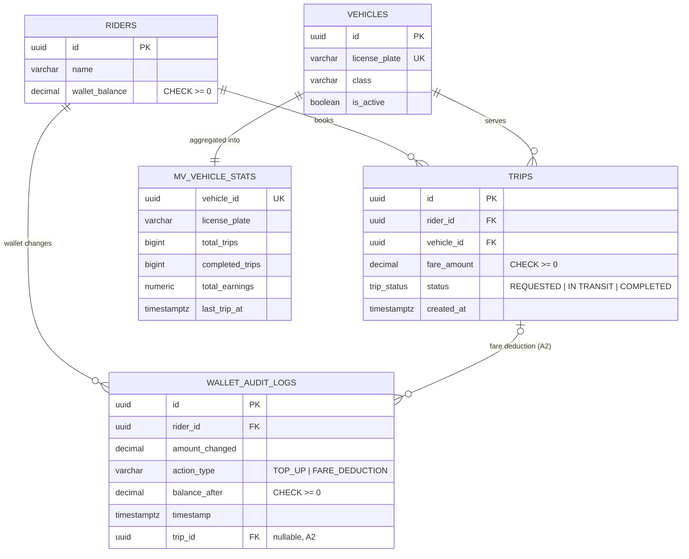

# RideSync: Backend (inherited from A1, fixed for A2)

**Project 2: RideSync, a global ride-hailing network.** PostgreSQL (riders, vehicles, trips, wallet audit)
plus MongoDB (vehicle catalog, trip reviews, live telemetry).

- Original A1 repository: https://github.com/dudekulamahammad/2026202016_a1
- This README covers the database layer the A2 front end is built on. Every change made to the inherited
  code is listed in [Changes to the inherited backend](#changes-to-the-inherited-backend). Backend fixes are edits
  to existing files; the only new file is `docs/handover_note.md` (required by A2).

| Folder | Contents |
|---|---|
| `sql/` | `01`–`06`: schema, indexes, triggers, stored procedures, materialized view, Workflow 2 |
| `mongo/` | `01` collections, validators and indexes; `02` Workflow 3 (`$geoNear`); `03` Workflow 4 (`$facet`); `run_all_mongo_workflows.js` demo report |
| `data_generations/` | `postgres_seeder.py` (also holds the shared fleet definition), `mongo_seeder.py` (also the `--live` ping stream), `generate_trip_reviews.py`, `get_geo_summary.py`, `generate_mongo_stats.py` |
| `performance/` | EXPLAIN evidence: A1 output plus an appended A2 section in `postgres_explain_analyzes.txt` |
| `docs/` | `handover_note.md`, `relational_erd.png` (A1 diagram, see [ERD notes](#erd-notes)), `mongo_schema_map.json` |
| `MongoCommands.txt` | Copy-paste MongoDB command reference |

---

## 1. Setup

Requirements: PostgreSQL 13+ (tested on 16), MongoDB 5.2+ (`$top` operator; 8.0 recommended), `mongosh`, Python 3.9+.

```bash
# --- Python drivers ---
python3 -m pip install psycopg2-binary pymongo

# --- PostgreSQL ---
export PGHOST=localhost PGPORT=5432 PGUSER=postgres PGPASSWORD=<your password> PGDATABASE=ridesync_v2
createdb ridesync_v2
for f in sql/0*.sql; do psql -v ON_ERROR_STOP=1 -f "$f" || break; done
python3 data_generations/postgres_seeder.py

# --- MongoDB (run 01 BEFORE seeding: it creates validators + indexes) ---
sudo systemctl start mongod
mongosh --quiet --file mongo/01_collections_and_indexes.js
python3 data_generations/mongo_seeder.py

# --- Live pings for Workflow 3 / the Map screen (leave running in its own terminal) ---
python3 data_generations/mongo_seeder.py --live
```

Environment variables used by every Python script:

| Variable | Default |
|---|---|
| `PGHOST` | `localhost` |
| `PGPORT` | `5432` |
| `PGDATABASE` | `ridesync_v2` |
| `PGUSER` | `postgres` |
| `PGPASSWORD` | prompted for if missing |
| `MONGO_URI` | `mongodb://127.0.0.1:27017/?directConnection=true` |
| `MONGO_DB` | `ridesync_db` |
| `SEED` | `42` (makes the generated data reproducible) |

### What the seeders create

| Store | Data |
|---|---|
| PostgreSQL | 1,000 riders; 100 vehicles (every 20th inactive, 5 total); 100,000 completed trips over 30 days; 100,000 wallet transactions, so **100,000+ `wallet_audit_logs` rows written by the trigger**, spread over 30 days; 30 active trips (20 `REQUESTED`, 10 `IN TRANSIT`) booked through `sp_book_ride`; refreshed `mv_vehicle_stats` |
| MongoDB | 100 `VehicleMetadata` (one per PostgreSQL vehicle); 100,000 `TripReviews`; 500,000 `TelemetryPings` (one continuous track per active vehicle) |

Vehicle and rider ids are **deterministic** (`uuid5`, defined once in `postgres_seeder.py` and imported by the Mongo
scripts), so both databases describe the same fleet and a re-seed produces the same ids.

## 2. Verify and demo

```bash
psql -d ridesync_v2 -f sql/06_window_analytics.sql          # Workflow 2 demo output (top 5 per day)
mongosh --quiet --file mongo/02_workflow3_geonear.js        # Workflow 3 (needs --live running)
mongosh --quiet --file mongo/03_workflow4_facet.js          # Workflow 4
mongosh --quiet --file mongo/run_all_mongo_workflows.js     # full Mongo report incl. explain
python3 data_generations/get_geo_summary.py                 # Workflow 3 at several locations
python3 data_generations/generate_mongo_stats.py            # refresh performance/mongo_*.json
```

Quick Workflow 1 check (the second call fails with RS006, the partial unique index):
```sql
SELECT id FROM riders WHERE name = 'Rider_0001';                       -- copy the id
SELECT id FROM vehicles WHERE is_active LIMIT 2;                       -- copy two ids
CALL sp_book_ride('<rider>', '<vehicle 1>', 250, NULL);                -- returns p_trip_id
SELECT * FROM wallet_audit_logs WHERE trip_id = '<p_trip_id>';         -- the row the trigger wrote
CALL sp_book_ride('<rider>', '<vehicle 2>', 100, NULL);                -- ERROR RS006
CALL sp_update_trip_status('<p_trip_id>', 'IN TRANSIT');
CALL sp_update_trip_status('<p_trip_id>', 'COMPLETED');                -- the rider can book again
```

---

## 3. Database contract for the API layer

The database does the work; the API only calls these objects.

### Workflow 1: booking (stored procedures)

```sql
CALL sp_book_ride(:rider_id, :vehicle_id, :fare, NULL);      -- returns one row: p_trip_id
CALL sp_update_trip_status(:trip_id, 'IN TRANSIT');          -- REQUESTED -> IN TRANSIT -> COMPLETED only
CALL sp_top_up_wallet(:rider_id, :amount, NULL);             -- returns one row: p_new_balance
SELECT * FROM wallet_audit_logs WHERE trip_id = :trip_id;    -- audit row written by the trigger
```

> The status enum value is `'IN TRANSIT'` with a **space** (the A1 README wrote `IN_TRANSIT`, which PostgreSQL rejects).

### Error codes (SQLSTATE)

The error code arrives as `err.code` (node-postgres) or `e.pgcode` (psycopg2). For RS006/RS007, the index name is in the error's constraint field and DETAIL, and the error's HINT has a suggested next step.

| Code | Meaning | Suggested HTTP |
|---|---|---|
| RS001 | Rider not found | 404 |
| RS002 | Vehicle not found | 404 |
| RS003 | Vehicle is not active | 409 |
| RS004 | Insufficient wallet balance (the CHECK constraint fired, everything rolled back) | 409 |
| RS005 | Invalid amount (fare or top-up must be > 0) | 400 |
| RS006 | Rider already has an active trip, blocked by `idx_unique_active_rider_trip` | 409 |
| RS007 | Vehicle already on an active trip, blocked by `idx_unique_active_vehicle_trip` | 409 |
| RS008 | Trip not found | 404 |
| RS009 | Invalid status transition | 409 |
| RS010 | `wallet_audit_logs` is append-only | 403 |

### Workflow 2 and the materialized view

```sql
SELECT * FROM fn_vehicle_revenue_moving_avg(:from_date, :to_date, :vehicle_id_or_null);   -- dates default to last 30 days
SELECT * FROM fn_vehicle_revenue_moving_avg(CURRENT_DATE, CURRENT_DATE) WHERE rank_on_day <= 10;
SELECT * FROM mv_vehicle_stats ORDER BY total_earnings DESC LIMIT 10;
SELECT mv_vehicle_stats_last_refreshed();          -- "last refreshed"
SELECT * FROM refresh_mv_vehicle_stats();          -- refresh button (CONCURRENTLY) -> refreshed_at, duration_ms
```

### Audit trail and browsing

```sql
-- One rider, date range, newest first; running balance = balance_after
SELECT timestamp, action_type, amount_changed, balance_after, trip_id
FROM wallet_audit_logs
WHERE rider_id = :rider_id AND timestamp >= :from AND timestamp < :to
ORDER BY timestamp DESC LIMIT :page_size OFFSET :offset;
```

### MongoDB pipelines

- **Workflow 3** (`mongo/02_workflow3_geonear.js`). Inputs: rider `[lon, lat]`, `maxDistance` (5000 m), freshness window (10 min).
  Returns one row per vehicle: `vehicleId` (= `vehicles.id`), `licensePlate`, `class`, `distanceKm`, `location`, `lastSeen`.
- **Workflow 4** (`mongo/03_workflow4_facet.js`). Optional `vehicleId` / date filters. Returns `rating_distribution` (always 5 buckets),
  `common_feedback` (top 10 tags) and `overall_average_rating` (`average_rating`, `total_reviews`).
- **Catalog**: `db.VehicleMetadata.findOne({ vehicleId })`. `specs` keys differ by class and fuel type, and `inspectionHistory`
  is a nested array, which suits the "flexible document" view.

---

## Changes to the inherited backend

Each problem below was found by running the A1 scripts (PostgreSQL 16) and reading the MongoDB scripts and the saved
explain output.

### PostgreSQL

| # | File | Problem in A1 | Change | Why |
|---|---|---|---|---|
| P1 | `05_materialized_views.sql` | `refresh_mv_vehicle_stats()` ran a plain (blocking) `REFRESH`; the spec requires `CONCURRENTLY` | Uses `REFRESH MATERIALIZED VIEW CONCURRENTLY` | Spec compliance; reads are not blocked during refresh |
| P2 | `05_materialized_views.sql` | No way to know when the view was last refreshed | `mv_refresh_log` table; refresh returns `refreshed_at`, `duration_ms`; `mv_vehicle_stats_last_refreshed()` | A2 Analytics screen needs "last refreshed" |
| P3 | `05_materialized_views.sql` | `last_trip_at` on the ERD but not in code; unclear column meanings | Added `vehicle_class`, `is_active`, `completed_trips`, `last_trip_at`; documented that `total_trips` counts every status and `total_earnings` completed trips only | Clearer summary numbers |
| P4 | `04_stored_procedures.sql` | The balance pre-check meant the wallet `CHECK` constraint never fired | The `CHECK` now rejects the overdraft, caught as RS004 | A1 spec: "rolls back on CHECK constraint failure" |
| P5 | `04_stored_procedures.sql` | A second active trip surfaced as a raw `23505`; all custom errors were `P0001` | Stable SQLSTATEs RS001–RS009 with message, detail, hint and constraint name | API can show friendly messages without parsing text |
| P6 | `04_stored_procedures.sql` | Procedure did not return the new trip id | `INOUT p_trip_id` (the 3-argument `CALL` still works) | UI shows the created trip |
| P7 | `04_stored_procedures.sql` | A fare of 0 created a trip with no audit row | Fare must be > 0 (RS005) | Every booking leaves an audit trail |
| P8 | `04_stored_procedures.sql` | No way to move trips through statuses or add funds | `sp_update_trip_status` (forward-only), `sp_top_up_wallet` | A2 requires status moves to demo the partial index |
| P9 | `02_indexes.sql` | One vehicle could be booked by two riders at once | `idx_unique_active_vehicle_trip` partial unique index (RS007) | Data integrity |
| P10 | `02_indexes.sql` | No index on `wallet_audit_logs(rider_id, timestamp)` (the ERD claimed one) | `idx_wallet_audit_rider_ts`; partial `idx_wallet_audit_trip (trip_id) WHERE trip_id IS NOT NULL` | Audit Trail screen; "audit row for this trip" |
| P11 | `02_indexes.sql` | `idx_trips_status_completed` indexed a constant column and was never chosen | Replaced by `idx_trips_completed_created (created_at) INCLUDE (vehicle_id, fare_amount) WHERE status='COMPLETED'` | Workflow 2 is now an **index-only scan** |
| P12 | `02_indexes.sql` | Single-column FK indexes; duplicate index on `license_plate` (UNIQUE already indexes it) | `(rider_id, created_at DESC)`, `(vehicle_id, created_at DESC)`; duplicate dropped; `lower(name)` prefix index | Paginated browsing |
| P13 | `03_triggers_and_audit.sql` | Audit timestamps used `CURRENT_TIMESTAMP` (same value for a whole transaction) | `clock_timestamp()` | Running balance can be ordered |
| P14 | `03_triggers_and_audit.sql` | Audit log described as immutable, but `UPDATE`/`DELETE` were allowed | `trg_wallet_audit_immutable` raises RS010 | A1 spec: "immutable logs" |
| P15 | `01_schema_ddl.sql` + `03` + `04` | Audit rows could not be tied to the trip that caused them | Nullable `wallet_audit_logs.trip_id`, set by `sp_book_ride` through a transaction-local setting | A2: "show the new audit entry" |
| P16 | `06_window_analytics.sql` | `ROWS BETWEEN 6 PRECEDING` over days *with trips* is not a 7-day window when there are gaps; no parameters; full-table scan | Function `fn_vehicle_revenue_moving_avg(from, to, vehicle, tz)` over a dense calendar; looks back 6 days before `from`; ranks across all vehicles before filtering; demo query kept at the end | Correct metric, callable from the API, uses the index |

### MongoDB

| # | File | Problem in A1 | Change | Why |
|---|---|---|---|---|
| M1 | `mongo_seeder.py`, `postgres_seeder.py`, `generate_trip_reviews.py` | Mongo fleet (`V00001`–`V00150` / up to `V05000`, `NYC-###`, `VAN`) did not match PostgreSQL (random UUIDs, `MH..AB....`) | Deterministic fleet defined once in `postgres_seeder.py`; `vehicleId` = PostgreSQL UUID; plates and classes match | Map and review results can be linked to bookable vehicles |
| M2 | `mongo/01..03` | `use ridesync_db` was commented out, so `mongosh --file` used the `test` database; 02/03 printed nothing | `db = db.getSiblingDB("ridesync_db")`; results printed | Scripts work as documented |
| M3 | `mongo/02_workflow3_geonear.js` | Returned *pings*: the same vehicle could appear several times; availability came from any ping, even old ones; about 215k docs examined, about 1 s | Latest fresh ping per vehicle (`$group` + `$top`), then availability filter, then `$lookup` plate and class | Correct result; fast enough to poll |
| M4 | `mongo/01_collections_and_indexes.js` | Plain 2dsphere index; no index for "latest ping per vehicle" | `{location: "2dsphere", createdAt: -1}` (replaces the A1 index), `{vehicleId: 1, createdAt: -1}`; TTL kept (7200 s) | Freshness filter inside the index scan |
| M5 | `mongo/01_collections_and_indexes.js` | No validators although the schema map promised them; not re-runnable | `$jsonSchema` validators; idempotent script | Data quality |
| M6 | `mongo_seeder.py` | All pings were 0–110 min old, so the 2 h TTL empties the map about 2 h after seeding; availability random per ping | Per-vehicle tracks with sticky availability; **`--live` mode** streams pings, with availability taken from PostgreSQL active trips | Map stays live; booking a ride marks the car busy |
| M7 | `mongo_seeder.py` | Tags random regardless of rating; flat rating distribution | Rating skew; tags match the sentiment; `riderId`; richer `VehicleMetadata` (`specs`, `inspectionHistory`) | Meaningful charts and catalog view |
| M8 | `mongo/03_workflow4_facet.js` | (logic correct) | Optional vehicle/date `$match` before `$facet`; always 5 rating buckets; review count | Reviews screen filters |
| M9 | `run_all_mongo_workflows.js`, `generate_mongo_stats.py` | Old Workflow 3/4 pipelines; explain parsing tied to one MongoDB version | Fixed pipelines; explain summary searches the whole document | Evidence matches the real workflows |
| M10 | `postgres_seeder.py`, `mongo_seeder.py`, `mongo/02`, `run_all_mongo_workflows.js`, `get_geo_summary.py`, `generate_mongo_stats.py`, `MongoCommands.txt` | Telemetry was generated around Manhattan while every plate is `MH..` (Maharashtra) | Fleet drives in Mumbai: land strips from Colaba to Andheri, random walk kept on land; Workflow 3 default origin is Dadar station; `--live` restarts cars whose last ping is outside Mumbai | Map, plates and pickup points describe one city; no cars in the sea |

### Scripts and documentation

| # | File | Change |
|---|---|---|
| D1 | `postgres_seeder.py` | Connection from env vars; deterministic ids; 30-day history; audit history spread over 30 days (A1 stamped all 100k rows with the seeding time); 30 active trips booked via the procedure; 5 inactive vehicles; MV refreshed and `VACUUM ANALYZE` after seeding (A1 left the MV empty); `TRUNCATE` instead of `DELETE` |
| D2 | `get_geo_summary.py` | Its `$facet` ran `$unwind` before faceting, which inflated rating counts, and it overwrote `mongo_execution_stats.json`. Now a print-only Workflow 3 summary for several locations, with the fixed pipeline |
| D3 | `generate_trip_reviews.py` | Uses the shared fleet and the same `review_doc()` as `mongo_seeder.py` (no orphan ids); `--target` option |
| D4 | `MongoCommands.txt` | Rewritten for the fixed scripts (database selection, `--live`, new indexes, explain commands) |
| D5 | `docs/mongo_schema_map.json` | Updated to the new fields, validators and indexes |
| D6 | `performance/postgres_explain_analyzes.txt` | A2 EXPLAIN section appended (A1 output kept unchanged above it) |
| D7 | `README.md` | Rewritten: the A1 README had no PostgreSQL setup steps and spelled the status `IN_TRANSIT` |

---

## ERD notes

`docs/relational_erd.png` is the original A1 diagram. Differences from the code:
- It shows a `wallet_action_type` enum (`RIDE_PAYMENT`, `REFUND`, …). The code uses `VARCHAR` with `TOP_UP` / `FARE_DEDUCTION`.
- It shows indexes on `wallet_audit_logs` that A1 never created (added in P10).
- It names the database `ridesync`; the scripts use `ridesync_v2`.

Current schema:



---

## Assumptions

- **Escrow**: the fare is taken from the wallet when the trip is booked (held for the trip). Completing a trip does not move money
  again. There is no `CANCELLED` status in the A1 spec, so there is no refund path.
- **Seeded history**: the 100,000 completed trips are historical imports and are not individually charged to wallets. The separate
  100,000 wallet transactions provide the ledger volume. Bookings made through `sp_book_ride` *are* charged and linked to their audit row.
- **Seeder back-fill**: wallet history is applied through real `UPDATE`s (trigger-written audit rows). The seeder then back-fills those
  rows' timestamps to a 30-day spread, with the append-only guard disabled **only inside that seeding transaction**. Runtime code cannot do this.
- **Workflow 3**: a vehicle's position and availability come from its most recent ping inside the radius within the last 10 minutes.
- **Day boundaries** in Workflow 2 use the session `TimeZone` unless a `p_tz` argument is given.
- Telemetry is simulated in Mumbai, matching the A1 `MH..` (Maharashtra) plates; A1 generated it in Manhattan. Cars move only on land strips
  (`LAND_ZONES` in `postgres_seeder.py`), and the map's pickup points are Mumbai landmarks. The data is synthetic.

## Performance evidence

- `performance/postgres_explain_analyzes.txt`: the A1 output, followed by an **A2 section** measured on the seeded database
  (100k trips, 100k audit rows). Workflow 2 now uses an **Index Only Scan on `idx_trips_completed_created`** (A1: Seq Scan plus an on-disk sort).
  The audit trail, rider trips, keyset browsing, active trips and MV top-10 queries all use indexes and run in under 1 ms.
- `performance/mongo_execution_stats.json` / `mongo_explain_raw.json` and the `workflow3/4_*.log` files still hold the **A1**
  numbers. Regenerate the JSON files with `python3 data_generations/generate_mongo_stats.py` after seeding and running `--live` for a minute.
- Workflow 4 necessarily scans `TripReviews`: stages inside `$facet` cannot use indexes. Filters go in the `$match` before it.
